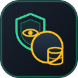

<p align="center"></p>

# modesty-db

> Free domain database

**Part of the [Modesty toolkit](https://github.com/sniffis-commits/modesty-meta)** — see the
[big README](https://github.com/sniffis-commits/modesty-meta) for the full picture, the rating scale and all repositories.

## What this is

Tooling that builds `nsfw.sqlite`: a SQLite file of pre-scored adult domains with per-source provenance. The file itself is the free downloadable product; weekly releases are published in this repo.

## How to


```bash
python src/import_blocklists.py                       # build data/nsfw.sqlite
python src/import_blocklists.py --backfill-sources    # fill source_id column
```
- Sources: StevenBlack porn alternate (MIT), Firebog Prigent-Adult (academic).
- Tables: `known_domains`, `domain_ratings`, `sources`, `scan_types`, `meta`, and media tables.
- Check source licences before redistributing derived data.
The generated `.sqlite` files are intentionally **not** committed here; get the
latest release from this repository's Releases page.


## Layout

| Path | Purpose |
|---|---|
| `src/` | source from the monorepo |
| `data/` | source from the monorepo |

## More

- Full overview and other repos: [modesty-meta](https://github.com/sniffis-commits/modesty-meta)
- Website: [https://modesty.cia.org.il](https://modesty.cia.org.il)
- Model weights: [modesty-models](https://github.com/sniffis-commits/modesty-models)
- Licence: MIT (see `LICENSE`). Third-party data/model terms are on the
  [site's licence page](https://modesty.cia.org.il/?p=licenses).
